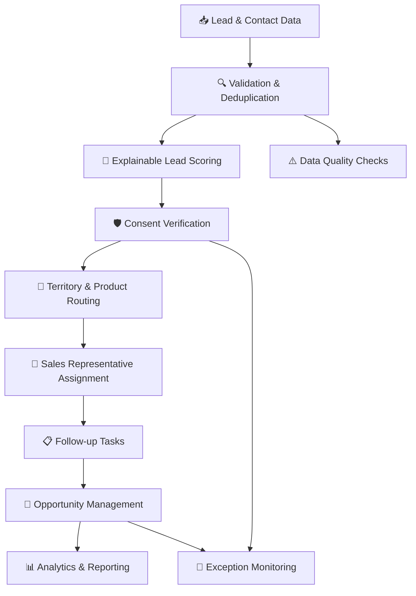

<div align="center">

# YottaFlex AI
### Lead Scoring & Opportunity Management System

**Turn lead data into explainable sales decisions.**

[](https://www.python.org/)
[](https://fastapi.tiangolo.com/)
[](https://streamlit.io/)
[](https://www.sqlite.org/)
[](#)

</div>

YottaFlex AI is an end-to-end B2B lead operations project. It brings together explainable lead scoring, duplicate handling, consent-aware follow-ups, territory and product routing, sales assignment, opportunity tracking, exception detection, and operational analytics in one application.

The project is designed around **traceability and data integrity**: scoring decisions retain explanations, stage changes are recorded as history, injected anomaly labels are kept separate from detector inputs, and generated exports include validation and manifest artifacts.


---

## 📌 Contents

- [What It Does](#-what-it-does)
- [Dashboard](#-dashboard)
- [Scoring Model](#-scoring-model)
- [Exception Monitoring](#-exception-monitoring)
- [Technology Stack](#-technology-stack)
- [Architecture](#-architecture)
- [Dataset](#-dataset)
- [Getting Started](#-getting-started)
- [Run the Application](#-run-the-application)
- [Testing and Validation](#-testing-and-validation)
- [API Safety](#-api-safety)
- [Project Structure](#-project-structure)
- [Documentation](#-documentation)
- [Known Limitations](#-known-limitations)
- [AI Use Disclosure](#-ai-use-disclosure)
- [License](#-license)

## 🚀 What It Does

| Capability | Description |
|---|---|
| Lead Scoring | Calculates Fit, Intent, and Engagement scores with an explanation trail. |
| Duplicate Management | Identifies and reconciles controlled natural duplicates without deleting source records. |
| Consent Governance | Checks consent before outreach tasks are treated as eligible. |
| Intelligent Assignment | Routes leads using territory/product coverage and assigns eligible sales representatives. |
| Task Management | Tracks follow-ups, priority, status, due dates, and consent blockers. |
| Opportunity Lifecycle | Tracks pipeline stages, outcomes, and append-only stage history. |
| Exception Intelligence | Detects five defined operational anomaly classes and evaluates detections against separated ground truth. |
| Data Quality & Analytics | Runs validation checks and exposes operational KPIs and export metadata. |
| REST API | Exposes pipeline and operational functionality through FastAPI. |

## 📊 Dashboard

The Streamlit dashboard contains nine sections:

1. **Executive Overview** — Business KPIs, funnel, and pipeline summary.
2. **Lead Explorer** — Search, filter, inspect, and export lead records.
3. **Scoring Intelligence** — Score distribution, component analysis, and evaluation views.
4. **Sales Assignment** — Assignment coverage, representative workload, and territory views.
5. **Task Management** — Follow-up status, priority, overdue work, and consent blockers.
6. **Opportunity Pipeline** — Stage distribution, values, outcomes, and loss reasons.
7. **Exception Intelligence** — Severity, evidence, detection metrics, and resolution history.
8. **Data Quality** — Validation results and data-quality indicators.
9. **Configuration & Audit** — Scoring configuration, dataset metadata, and export integrity details.

The dashboard uses the project's current database and generated artifacts. Its intelligence panel is based on deterministic rules and recorded system data; it should not be mistaken for a trained generative-AI model.

## 🧠 Scoring Model

Each component is measured on a 0–100 scale. The composite score is calculated as:

```text
Lead Score = (Fit × 0.40) + (Intent × 0.35) + (Engagement × 0.25)
```

| Band | Score Range |
|---|---:|
| Hot | 80–100 |
| Warm | 60–79 |
| Nurture | 40–59 |
| Cold | 0–39 |

The thresholds and component weights are configurable. Score explanations record the rules and contributions behind a score. Activity-based scoring applies a temporal cutoff so events after the scoring timestamp are excluded.

## 🔍 Exception Monitoring

The project models and detects five exception categories:

| Exception | Intended Control |
|---|---|
| `opted_out_lead_contacted` | Prevents outreach where valid consent is absent or revoked. |
| `score_uses_post_conversion_event` | Identifies scoring evidence that occurs after conversion. |
| `lead_assigned_outside_territory` | Identifies assignment outside representative territory coverage. |
| `duplicate_creates_duplicate_opportunity` | Identifies multiple opportunities associated with one lead. |
| `stage_history_has_gaps` | Identifies invalid or skipped opportunity-stage transitions. |

Injected anomaly ground truth is stored separately from operational detector inputs. Evaluation metrics should be interpreted with the methodology and limitations documented in the repository, not as a claim of production-world model accuracy.

## 🛠️ Technology Stack

- **Language:** Python 3.12+
- **API:** FastAPI, Uvicorn, Pydantic
- **Dashboard:** Streamlit, Plotly
- **Data & Persistence:** SQLAlchemy 2, SQLite, Pandas, NumPy
- **Configuration:** YAML, Pydantic Settings
- **Testing:** Pytest, HTTPX

## 🏗️ Architecture

```text
                 Streamlit Dashboard
                         |
                    FastAPI REST
                         |
                Application Layer
                         |
                Pipeline Orchestrator
                         |
       +-----------------+------------------+
       |                 |                  |
   Data & Schema     Domain Engines    Analytics/Export
       |                 |                  |
       +-----------------+------------------+
                         |
                   SQLite Database
                         |
              CSV / JSON / SQL Exports
              Manifests and Validation
```

The pipeline coordinates data generation, validation, deduplication, scoring, consent checks, routing, assignment, task creation, opportunity processing, stage history, exception detection, analytics, and export.

See [ARCHITECTURE.md](docs/ARCHITECTURE.md) and [ERD.md](docs/ERD.md) for detailed diagrams and relationships.

## 📁 Dataset

The committed full-scale dataset is generated with seed `20261022`.

| Entity | Count |
|---|---:|
| Leads | 20,000 |
| Contacts | 10,000 |
| Companies | 5,000 |
| Opportunities | 3,000 |
| Campaigns | 30 |
| Sales Representatives | 80 |
| Territories | 16 |
| Products | 10 |

The repository includes CSV exports, split SQL exports, ground-truth files, a dataset manifest, checksums, validation summary, and a pipeline result summary under `data/`.

**Note:** These are synthetic challenge/demo data, not real customer records.

## ⚙️ Getting Started

### Prerequisites

- Python 3.12 or newer
- Git

### 1. Clone the Repository

```bash
git clone https://github.com/Sudhakar-2005/YottaFlex_Leadscoring_intelligence.git

cd YottaFlex_Leadscoring_intelligence
```

### 2. Create a Virtual Environment

```bash
python -m venv .venv
```

Activate it:

**Windows PowerShell**

```powershell
.\.venv\Scripts\Activate.ps1
```

**macOS / Linux**

```bash
source .venv/bin/activate
```

### 3. Install Dependencies

```bash
python -m pip install --upgrade pip

pip install -r requirements.txt

pip install -e .
```

## ▶️ Run the Application

### Start the Dashboard

```bash
streamlit run app/dashboard.py
```

Streamlit prints the local URL in the terminal, typically:

```text
http://localhost:8501
```

### Start the API

```bash
uvicorn yottaflex.api.main:app --reload
```

API base URL:

```text
http://127.0.0.1:8000
```

Interactive API documentation:

```text
http://127.0.0.1:8000/docs
```

### Generate Data

Starter-scale smoke run without anomaly injection:

```bash
python scripts/generate_data.py --scale starter --no-inject
```

Full-scale generation:

```bash
python scripts/generate_data.py --scale full
```

To intentionally refresh the committed full-scale export set, use the explicit export destination and overwrite permission only after reviewing the impact:

```bash
python scripts/generate_data.py --scale full --export-dir data/exports --overwrite-exports
```

## 🧪 Testing and Validation

Run the test suite:

```bash
pytest -q
```

Run data validation:

```bash
python scripts/validate_data.py
```

Run starter-scale reproducibility comparison:

```bash
python scripts/compare_reproducibility.py --scale starter
```

Full-scale reproducibility comparison:

```bash
python scripts/compare_reproducibility.py --scale full
```

The repository includes recorded V3.2.5 test output at [`docs/evidence/v3_2_5_pytest_full.txt`](docs/evidence/v3_2_5_pytest_full.txt), plus dashboard and validation evidence.

The recorded output reports **102 passing tests**. This is committed run evidence; results can vary if dependencies, environment, or source files change.

## 🔐 API Safety

`POST /api/v1/pipeline/run-all` can regenerate pipeline data and is therefore destructive when pointed at the live database.

The API requires explicit destructive confirmation for the live database. For safer isolated runs, provide a separate `output_database_url` and disable report writing where appropriate.

**Do not expose this API publicly as-is.** Authentication and authorization are documented open limitations.

Review [API.md](docs/API.md) and [KNOWN_LIMITATIONS.md](docs/KNOWN_LIMITATIONS.md) before running outside a trusted local environment.

## 📂 Project Structure

```text
YottaFlex_Leadscoring_intelligence/
│
├── app/                  # Streamlit dashboard and UI components
├── config/               # Dataset and scoring configuration
├── data/                 # Committed exports and pipeline report
├── docs/                 # Architecture, rules, audit, evidence, AI disclosure
├── scripts/              # Generation, validation, restore and reproducibility
├── src/
│   └── yottaflex/        # API, database models, pipeline and domain engines
├── tests/                # Unit and integration tests
│
├── requirements.txt
├── pyproject.toml
└── README.md
```

## 📚 Documentation

| Document | Purpose |
|---|---|
| [Architecture](docs/ARCHITECTURE.md) | System components and pipeline flow |
| [ERD](docs/ERD.md) | Entity relationships |
| [Business Rules](docs/BUSINESS_RULES.md) | Scoring, consent, routing, and lifecycle rules |
| [Data Dictionary](docs/DATA_DICTIONARY.md) | Dataset and field reference |
| [API Reference](docs/API.md) | API endpoints and behavior |
| [Testing](docs/TESTING.md) | Test approach and commands |
| [Validation Summary](docs/VALIDATION_SUMMARY.md) | Data validation methodology and results |
| [Known Limitations](docs/KNOWN_LIMITATIONS.md) | Accepted gaps and future work |
| [Technical Decisions](docs/TECHNICAL_DECISIONS.md) | Key implementation decisions |
| [AI Prompt History](docs/AI_PROMPT_HISTORY.md) | Development AI-use disclosure |
| [UI Implementation Report](docs/UI_IMPLEMENTATION_REPORT.md) | V3.2.5 dashboard redesign notes |
| [Final Submission Checklist](docs/FINAL_SUBMISSION_CHECKLIST.md) | Submission readiness checklist |

## ⚠️ Known Limitations

This is a challenge/demo implementation, not a production-ready CRM.

Important documented limitations include:

- No API authentication or authorization.
- SQLite is single-writer and is not intended for concurrent production workloads.
- Stage-history append-only behavior is application-enforced, not protected by database triggers.
- Deduplication currently uses exact email/domain rules rather than fuzzy entity resolution.
- No PII masking layer for exports; only synthetic data should be used in the included demo.
- Streamlit UI does not have a comprehensive automated browser-test suite.
- Scoring is rule-based; the held-out split is a reporting/evaluation split, not a trained predictive model.

See [KNOWN_LIMITATIONS.md](docs/KNOWN_LIMITATIONS.md) for the full list and release disposition.

## 🤖 AI Use Disclosure

AI tools were used as development assistance.

The repository's [AI Prompt History](docs/AI_PROMPT_HISTORY.md) records significant prompts, implementation assistance, and decisions.

The project owner remains responsible for understanding, reviewing, testing, and explaining the submitted implementation.

## 📄 License

See the [`LICENSE`](LICENSE) file for the applicable terms.

The repository currently includes an MIT license. Review it before reusing or redistributing this project.

---

<div align="center">

**YottaFlex AI · V3.2.5**

*Built as an explainable, auditable lead operations challenge project.*

</div>

## 🎬 Quick Visual Demo

Explore how YottaFlex AI transforms raw lead data into actionable sales operations.

### 1. Launch the Dashboard

```bash
streamlit run app/dashboard.py
```

Open the local URL displayed in your terminal (usually `http://localhost:8501`).

### 2. Explore the Workflow



### 3. Explore the Dashboard Modules

| Dashboard Section | What You Can Explore |
|---|---|
| Executive Overview | Business KPIs and lead funnel |
| Lead Explorer | Lead records, filters, and score details |
| Scoring Intelligence | Fit, Intent, Engagement, and score bands |
| Sales Assignment | Territory routing and representative workload |
| Task Management | Follow-ups and consent blockers |
| Opportunity Pipeline | Opportunity stages and outcomes |
| Exception Intelligence | Operational anomaly detection |
| Data Quality | Validation results |
| Configuration & Audit | Scoring rules and audit information |

### 4. Try the REST API

Start the API:

```bash
uvicorn yottaflex.api.main:app --reload
```

Explore the interactive Swagger documentation:

`http://127.0.0.1:8000/docs`

> **Visual note:** Dashboard screenshots and a short screen-recording walkthrough can be added under `docs/screenshots/` when clean final-release captures are available.
