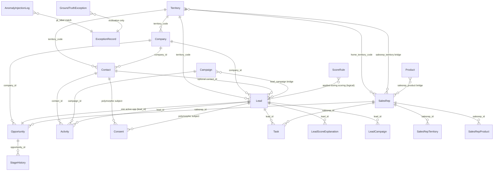

# Entity Relationship Diagram

## Core ER (mermaid)

## Cardinality summary

| Relationship | Cardinality | Notes |
|--------------|-------------|-------|
| Territory → Company/Contact/Lead | 1:N | FK territory_code |
| Company → Contact | 1:N | RESTRICT on delete |
| Company → Lead | 1:N | |
| Contact → Lead | 1:N optional | identity link on ~50% leads |
| Lead → Activity | 1:N | |
| Lead → Consent | 1:N | polymorphic (subject_type='lead') |
| Contact → Consent | 1:N | subject_type='contact' |
| Campaign → Activity | 1:N | |
| Lead ↔ Campaign | M:N | bridge `lead_campaign` |
| Lead → Task | 1:N | |
| Lead → Opportunity | 1:1 active | partial uniqueness enforced in app |
| SalesRep → Task/Opportunity | 1:N | |
| SalesRep ↔ Territory | M:N | bridge `salesrep_territory` |
| SalesRep ↔ Product | M:N | bridge `salesrep_product` |
| Opportunity → StageHistory | 1:N | append-only |
| Lead → LeadScoreExplanation | 1:N | one per scoring run |

## The 11 required entities

1. Company 2. Contact 3. Lead 4. Campaign 5. Activity 6. Consent  
7. ScoreRule 8. SalesRep 9. Task 10. Opportunity 11. StageHistory  

Supporting tables (Territory, Product, bridges, explanation, GT/exception) implement routing, M:N, explainability, and evaluation **without replacing** the core 11.

## Integrity rules

- `PRAGMA foreign_keys=ON` on every SQLite connection.
- Master data `ON DELETE RESTRICT`.
- Activity CHECK: at least one of lead/contact/company.
- StageHistory: no UPDATE/DELETE from application code (tested).
- Soft dedup via `is_duplicate_of` self-FK — never hard delete.
